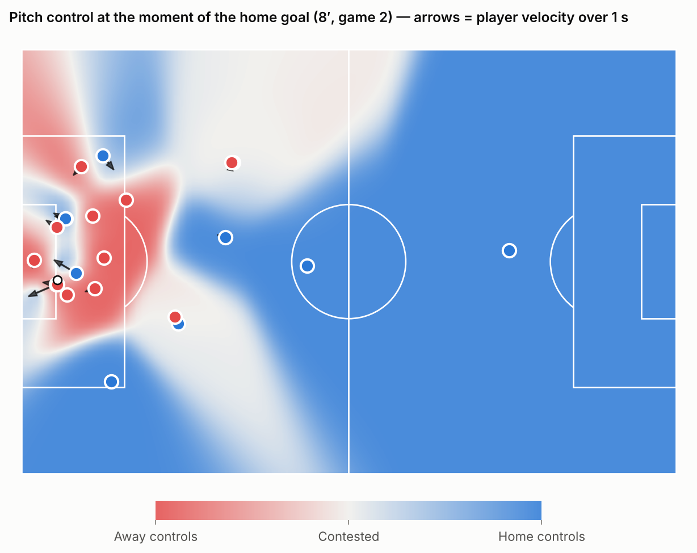
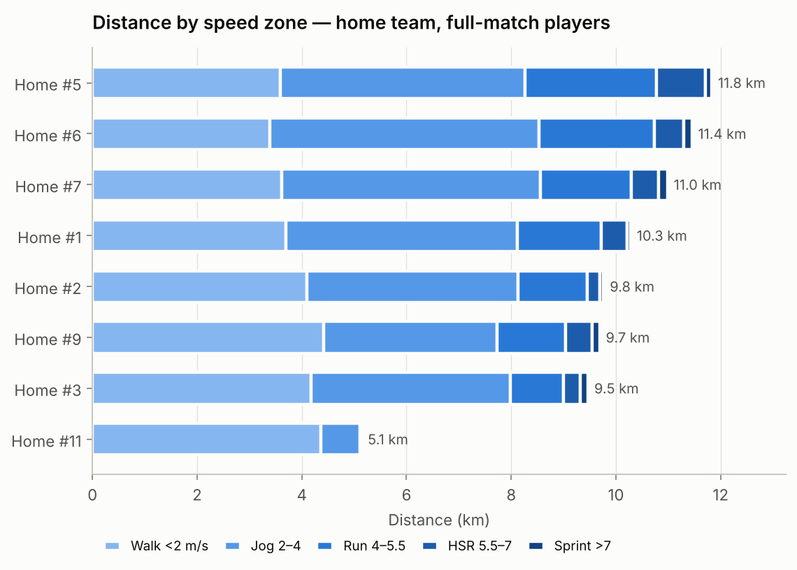
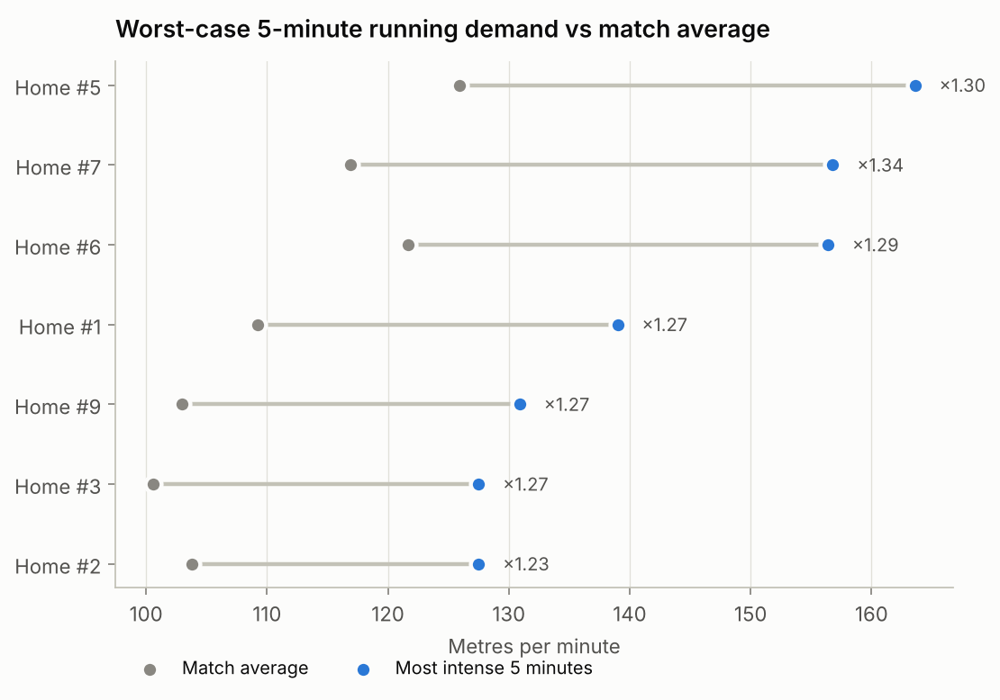
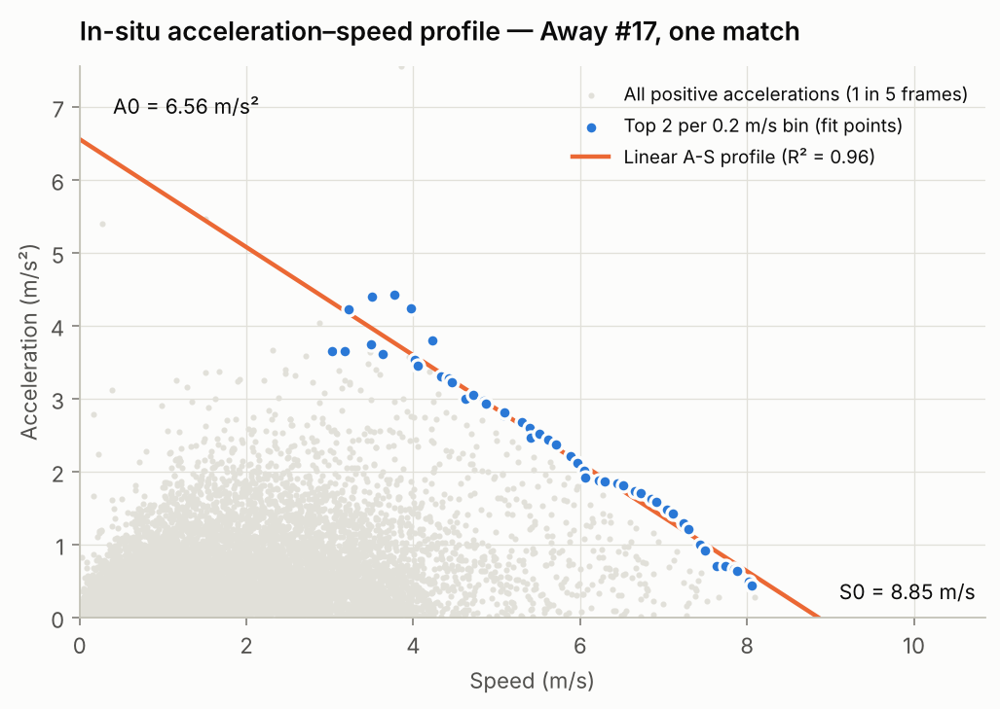

# football-tracking-analysis

[](https://github.com/Clement0242/football-tracking-analysis/actions/workflows/tests.yml)


Sport-science analysis of **25 Hz player tracking data** (Metrica Sports open
data, two professional matches): running loads, accelerations and
decelerations, in-situ acceleration–speed profiles, worst-case demands and a
vectorised implementation of **Spearman's pitch-control model**.

*Version française plus bas.*



## What it does

| Module | Content |
|---|---|
| `pitchtrack.io` | Reads Metrica CSVs, converts to metres on a 105 × 68 m pitch centred on the kick-off spot |
| `pitchtrack.kinematics` | Filtered velocity / acceleration, speed-zone distances, acceleration & deceleration efforts, rolling intensity |
| `pitchtrack.profiles` | In-situ acceleration–speed profile (A0, S0) after Morin et al. (2021) |
| `pitchtrack.pitch_control` | Spearman (2018) pitch control, integrated on the whole grid at once with NumPy |
| `scripts/make_figures.py` | Every figure and results table below |

## Results

**Running load.** Full-match outfield players cover a median of ~10 km, with
450–570 m of high-speed running (> 5.5 m/s). Decelerations above 2.5 m/s²
outnumber accelerations for 88 % of players — the braking load that matters
for injury prevention and is invisible in distance-only reports.



**Worst-case scenarios.** The most intense 5 minutes run at 1.23–1.34 × the
match average. Training drills prescribed from match *averages* therefore
underload players relative to what a match actually asks of them.



**Acceleration–speed profile from match data.** Fitting the maximal
accelerations a player produces at each speed gives his theoretical maximal
acceleration (A0) and speed (S0) without a sprint test. Median A0 is
6.2 m/s², in the range reported for professional footballers. One match is
often not enough: profiles with R² < 0.7 are flagged as unreliable in
`results/acceleration_speed_profiles_game2.csv`.



**Pitch control.** For each 1 m² of the pitch, the probability that each team
would control a ball played there now, from players' positions and
velocities (top image).

## Methodological choices

- **Filtering.** Velocity is smoothed with a Savitzky–Golay filter over 0.5 s,
  acceleration over 1 s. With shorter windows the A-S profile returns A0
  values above 15 m/s², which no player produces: acceleration is a second
  derivative and amplifies tracking noise. Effort counts depend heavily on
  this choice, which is why the thresholds are explicit parameters.
- **Tracking errors.** Speeds above 12 m/s and accelerations above 10 m/s²
  are discarded; fragments of track shorter than the filter are dropped.
- **Pitch control integration.** Instead of the usual Euler step, each
  integration step uses the exact solution of the control equation, so the
  probabilities can never sum above 1 even when many players arrive together.

## Run it

```bash
git clone https://github.com/Clement0242/football-tracking-analysis
cd football-tracking-analysis
pip install -e ".[dev]"
python scripts/download_data.py      # Metrica open data (~230 MB) into data/metrica
python scripts/make_figures.py       # figures/ and results/
pytest                               # synthetic-trajectory tests, no data needed
```

## References

- Spearman, W. (2018). *Beyond Expected Goals.* MIT Sloan Sports Analytics Conference.
- Morin, J.-B. et al. (2021). Individual acceleration-speed profile in-situ: a proof of concept in professional football players. *Journal of Biomechanics*, 123.
- Data: [Metrica Sports sample data](https://github.com/metrica-sports/sample-data).

---

## En français

Analyse sport science de données de tracking à 25 Hz (deux matchs
professionnels, open data Metrica Sports) :

- charge de course par zone de vitesse ;
- accélérations et décélérations ;
- profil accélération–vitesse *in situ* (A0, S0) ;
- demandes « pire scénario » sur 5 minutes ;
- modèle de **pitch control** de Spearman, vectorisé.

**À retenir :**
- Les décélérations dépassent les accélérations chez 88 % des joueurs.
- Les 5 minutes les plus intenses représentent 1,23 à 1,34 fois la moyenne du match.
- L'A0 médian (6,2 m/s²) est cohérent avec la littérature. Il n'est obtenu qu'au prix d'un lissage d'une seconde sur l'accélération : sans lui, le bruit du tracking produit des valeurs physiologiquement impossibles.

Auteur : [Clément Verdier](https://clement0242.github.io), ingénieur data et
sport scientist.
