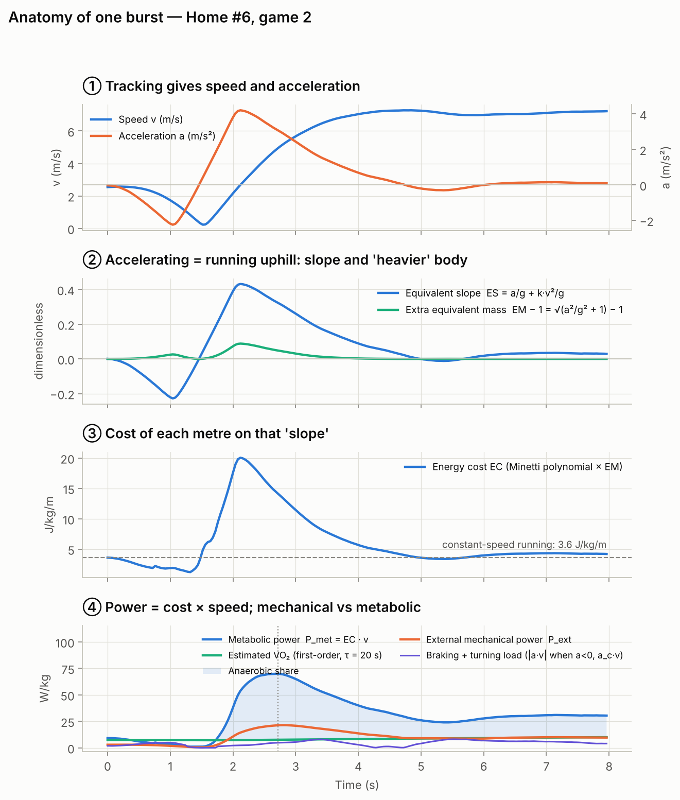
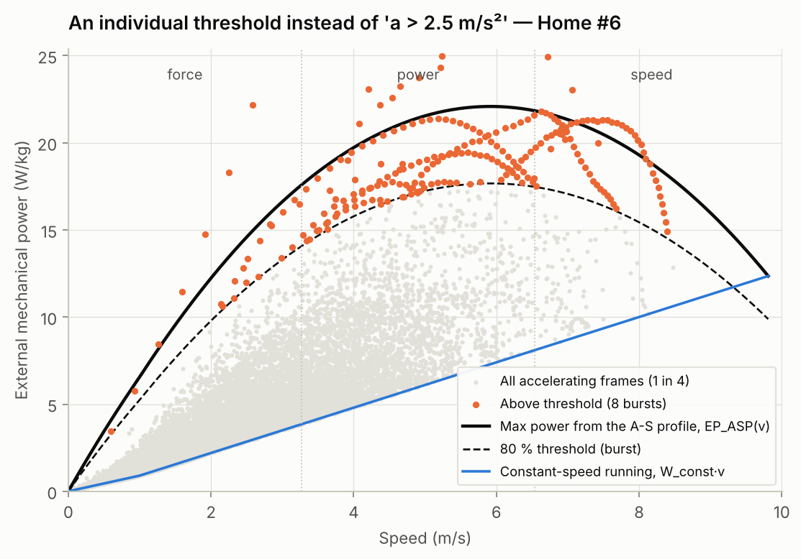
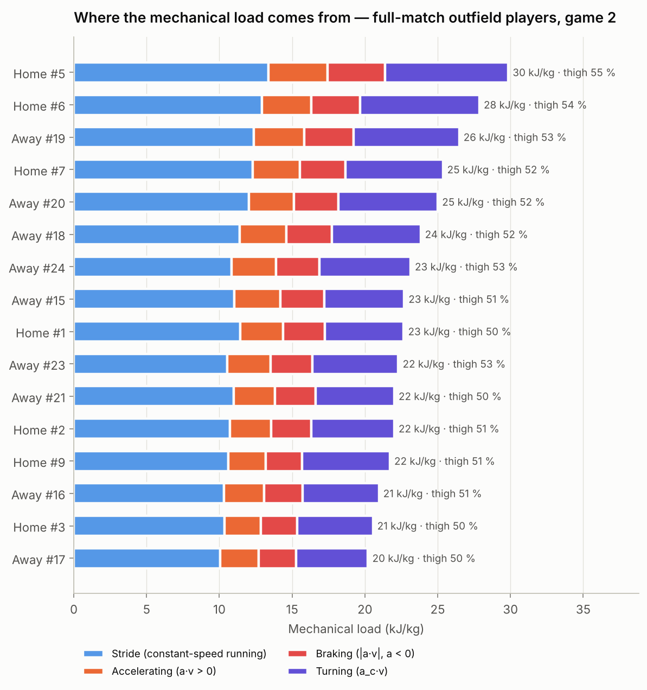

# Mechanical and metabolic power, step by step

Tracking providers report "metabolic power" or "mechanical power" as a single
number. This page shows how such a number is built from positions, with every
equation, every constant and every choice I made. The code that implements it
is `src/pitchtrack/power.py`, one function per equation.

*Résumé en français en bas de page.*

---

## 0. Two different "powers"

Before computing anything, it helps to separate two quantities that are
often confused.

| | **Mechanical power** | **Metabolic power** |
|---|---|---|
| Question | How much work do the muscles do on the body? | How much energy does the body spend to do it? |
| Unit | W/kg of work | W/kg of chemical energy (≈ O₂ equivalent) |
| Main source | di Prampero et al. 2023 (Part I), Osgnach et al. 2023 (Part II) | di Prampero & Osgnach 2018, updating Osgnach et al. 2010 |
| Typical match average | ~4 W/kg | ~7 W/kg |
| Ratio | | metabolic ≈ mechanical / efficiency |

Buchheit's GPS 3.0 argues for **mechanical** quantities, which are closer to
neuromuscular load, rather than metabolic power. This repository computes
both, side by side.

---

## 1. Input: speed and acceleration

From the 25 Hz positions (`pitchtrack.kinematics.add_velocities`):

- the velocity vector $(v_x, v_y)$ is filtered with a Savitzky–Golay filter
  over 0.5 s;
- the tangential acceleration $a = \mathrm{d}|v|/\mathrm{d}t$ (change of
  speed) and the centripetal acceleration $a_c = |v \times a| / |v|$ (change
  of direction) are filtered over 1 s;
- speeds above 12 m/s and accelerations above 10 m/s² are discarded as
  tracking errors;
- $a_c$ is set to 0 below 1 m/s, where the direction of motion is not
  defined.

**Why 1 s for acceleration.** It is a second derivative, so it amplifies
noise. With a 0.3 s window, the in-situ acceleration–speed profile gives
A0 ≈ 17 m/s², which is physiologically impossible. With 1 s, the median A0
is 6.2 m/s², in line with Osgnach et al. 2023 (6.43 ± 0.30). Every count
of "efforts above a threshold" depends heavily on this choice. That is a
general property of tracking data, not a weakness of this code, and it is
why the window is a visible parameter.

**Noise floor of the direction signal.** On the Metrica data, position
jitter is about 1.4 cm. A simulated straight run with that much noise gives
a mean $a_c$ of 0.06 m/s², while players average 0.8–1.1 m/s² between 2 and
8 m/s. The turning signal is therefore real. With 10 cm noise, which is
typical of GPS, the same straight run would show 0.4–1.4 m/s² of spurious
turning (`tests/test_power.py`).

---

## 2. Metabolic power (di Prampero & Osgnach 2018)

**Key idea.** Accelerating on flat ground puts the body in the same posture,
and makes it produce the same forces, as running uphill at constant speed.
Decelerating is like running downhill. The energy cost of uphill and
downhill running was measured on a treadmill (Minetti et al. 2002). So
accelerated running can be converted into an *equivalent* uphill run, and
its cost read from Minetti's curve.

| Step | Equation | Paper |
|---|---|---|
| Equivalent slope | $ES = a/g + k\,v^2/g$, with $k = 0.0037$ (air drag) | 2018 eq. 7 |
| Equivalent mass | $EM = \sqrt{a^2/g^2 + 1}$, ≥ 1 even when braking | 2018 eq. 8 |
| Gait | walking if $v < v_{trans}(ES)$, a 5th-degree polynomial | 2018 eq. 12 |
| Running cost | $EC = (155.4ES^5 - 30.4ES^4 - 43.3ES^3 + 46.3ES^2 + 19.5ES + EC_0)\cdot EM$ | 2018 eq. 10 |
| Walking cost | 4th-degree polynomial in $v$ per slope (Table 1), linearly interpolated between slopes, × EM | 2018 eq. 13–14 |
| Power | $P_{met} = EC \cdot v$ | 2018 eq. 1 |

$EC_0 = 3.6$ J/kg/m (Minetti 2002, flat compact terrain). Osgnach et al.
2010 multiplied the cost by a grass factor $K_T = 1.29$. This is the
`terrain` argument, default 1.0. With 1.0, the energy spent per metre
(4.1 J/kg/m for the busiest player) is close to the one implied by
Osgnach et al. 2023 (46.4 kJ/kg for a Serie B match). With 1.29, it would be
about 30 % higher.

**Not capped.** Minetti measured slopes up to ±0.45. A 5 m/s² acceleration
already gives ES ≈ 0.51. Like the papers, the polynomial is extrapolated, not
capped. Capping would make Bolt's published peak of ~140 W/kg impossible to
reach (a regression test checks this).

### Oxygen uptake, anaerobic energy and metabolic power events

$P_{met}$ is the *requirement*. VO₂ follows it with a delay:

$$\frac{\mathrm{d}\,VO_2}{\mathrm{d}t} = \frac{\min(P_{met}, VO_{2max}) - VO_2}{\tau}, \qquad \tau = 20~\text{s},\ VO_{2max} = 18~\text{W/kg}$$

- **Anaerobic energy:** $AnE = \int \max(P_{met} - VO_2, 0)\,\mathrm{d}t$.
- **MPE (metabolic power event):** a spell with $P_{met} > VO_2$, lasting
  ≥ 1 s and peaking above 20 W/kg.

These three settings (τ, VO₂max and the MPE criteria) are **my operational
choices**. The paper that defines the original procedure (Osgnach & di
Prampero 2018, Part 2) was not available. The fact that they reproduce the
published values (table below) is the check.

---

## 3. External mechanical power (di Prampero et al. 2023, Part I)

| Step | Equation |
|---|---|
| Work per metre at constant speed | $W_{const} = 1.3 - 0.4/v$ J/kg/m (Pavei et al. 2019; air drag included) |
| Constant-speed power | $P_{const} = W_{const}\cdot v$ |
| Power to change speed | $P_{acc} = a\cdot v$ (kinetic energy rate) |
| External power (concentric) | $P_{ext} = P_{const} + \max(P_{acc}, 0)$ |
| Braking power (eccentric) | $P_{brake} = \max(-P_{acc}, 0)$ |

Two notes:

- $W_{const}$ diverges at very low speed, so it is held at its 1 m/s value
  below 1 m/s.
- Internal power, the work needed to swing the limbs relative to the centre
  of mass, is left out, as in Part II, because stride frequency and duty
  factor cannot be measured from tracking.

### Bursts: an individual threshold instead of "a > 2.5 m/s²" (Part II)

The in-situ acceleration–speed profile $a_{max}(v) = A_0(1 - v/S_0)$ (Morin
et al. 2021) gives the highest power a player can produce at each speed:

$$EP_{ASP}(v) = W_{const}(v)\,v + a_{max}(v)\,v$$

- A **burst** is a stretch where $P_{ext} > 0.8\,EP_{ASP}(v)$.
  - The 80 % comes from Margaria et al. 1971.
- Work done above that threshold is split into three zones by speed:
  - force: 0 – ⅓ S0;
  - power: ⅓ – ⅔ S0;
  - speed: ⅔ – 1 S0.
- Each player uses his own profile when it is reliable (R² ≥ 0.7). Otherwise
  he gets the median of the reliable profiles in the match (Part II used the
  average of players in the same role).
- **My addition:** near S0 the threshold falls *below* the cost of running
  at constant speed, which would turn any steady sprint into a "burst". A
  burst therefore also needs $a\cdot v > 1$ W/kg, i.e. a real acceleration.

---

## 4. Direction-sensitive mechanical load (Buchheit, GPS 3.0)

Speed is a scalar, but velocity is a vector. Running a curve at constant
speed is an acceleration ($a_c = v^2/r$) and needs lateral force. Classic
GPS metrics treat it as straight running. The ADI analyser behind
Buchheit's own figures is proprietary. Here is an open version of the same
idea:

| Quantity | Definition |
|---|---|
| Turning index | $P_{turn} = a_c\cdot v$ |
| Mechanical load (intensity) | $P_{mech} = P_{const} + |a\cdot v| + P_{turn}$ |
| $MW_{stride}$ | $\int P_{const}\,\mathrm{d}t$: stride-dominated running |
| $MW_{thigh}$ | $\int (|a\cdot v| + P_{turn})\,\mathrm{d}t$: accelerating, braking, turning |
| MIP | highest rolling mean of $P_{mech}$ over 1 and 3 min |
| IET | time above the individual 80 % threshold of section 3 |

**Honest physics.** A centripetal force is perpendicular to the motion, so it
does no work on the centre of mass. $P_{turn}$ is therefore a force × speed
*index*, put on the same scale as the other terms, as GPS 3.0 does. In the
same way, $P_{mech}$ adds absolute values: it measures load, not net work.
Every component is also reported on its own, so each can be kept or
dropped.

---

## 5. Worked example: one instant, by hand

Home #6, game 2, at the peak of the burst shown at the top of the page
(`results/power_worked_example.json`):

| | Value | Calculation |
|---|---|---|
| Speed $v$ | 4.950 m/s | from tracking |
| Acceleration $a$ | 3.076 m/s² | from tracking |
| ES | 0.3228 | 3.076/9.81 + 0.0037 × 4.950² / 9.81 = 0.3135 + 0.0092 |
| EM | 1.0480 | √(1 + (3.076/9.81)²) |
| Gait | running | $v_{trans}$(0.32) ≈ 0.9 m/s < 4.95 |
| Polynomial | 13.476 | 0.544 − 0.330 − 1.456 + 4.824 + 6.294 + 3.6 |
| EC | 14.12 J/kg/m | 13.476 × 1.048, i.e. **3.9 ×** the cost of a steady metre |
| $P_{met}$ | **69.9 W/kg** | 14.12 × 4.950 |
| $P_{const}$ | 6.03 W/kg | (1.3 − 0.4/4.950) × 4.950 |
| $P_{acc}$ | 15.22 W/kg | 3.076 × 4.950 |
| $P_{ext}$ | **21.3 W/kg** | 6.03 + 15.22 |
| Apparent efficiency | 0.30 | 21.3 / 69.9: typical of hard accelerations, when little elastic energy is recycled (di Prampero et al. 2023) |
| Estimated VO₂ | 7.6 W/kg | the remaining 62 W/kg come from anaerobic stores |

---

## 6. Does it reproduce the literature?

Medians over full-match outfield players, Metrica games 1 and 2, with no
parameter tuned to match:

| Indicator | This repository | Published | Source |
|---|---|---|---|
| Energy-distance index (EDI) | 1.16 (1.13–1.30) | 1.20 (1.15–1.35) | Osgnach et al. 2010 |
| Anaerobic share (AnE/EE) | 39 % (37–48) | 40.1 ± 1.6 % (36–45) | Osgnach et al. 2023 |
| MPE per 15 min | 28.5 | 28 → 21 over the match | Osgnach et al. 2023 |
| MPE duration | 5.3 s | ~6 s | Osgnach et al. 2023 |
| MPE mean power | 19 W/kg | ~22 W/kg | Osgnach et al. 2023 |
| Recovery between MPE | 26 s | 26 → 37 s | Osgnach et al. 2023 |
| Distance above 20 W/kg / total | 0.15 | 0.25 ± 0.03 | Osgnach et al. 2023 |
| Bursts / accelerations > 2.5 m/s² | 0.95 | 1.61 | Osgnach et al. 2023 |

The metabolic indicators, which integrate over seconds, agree closely. The
two threshold-count indicators come out lower, for a known reason: the 1 s
acceleration filter trims short peaks that an 18 Hz GPS processed with
another filter keeps. This is the sensitivity to processing that Buchheit
describes, and it is why counts should never be compared across systems or
filters.

---

## 7. What these numbers cannot tell you

These are the limits that Buchheit and colleagues have documented, and they
apply here too:

- **Metabolic power underestimates the real energy cost of football
  actions.** Measured against VO₂, it is 29 % lower during soccer-specific
  circuits and 85 % lower during recovery (Buchheit et al. 2015).
- **It moves the opposite way to muscle activity when changing direction.**
  It rates a sprint with a 90° turn as *less* demanding than a 45° one, and
  both as less demanding than a straight sprint, while muscle activity (EMG)
  is *higher*. Its ratio to muscle activity is 2 to 4 times lower when
  decelerating than when accelerating (Hader et al. 2016). This is the main
  argument for the mechanical, direction-sensitive quantities of section 4.
- **Tracking cannot see actions without displacement.** Duels, jumps,
  tackles and upper-body work are invisible.
- **Metabolic power is not internal load.** Heart rate says more about
  cardiorespiratory strain. Mechanical quantities are closer to
  neuromuscular load, but they still describe external locomotion.
- **The internal power of the limbs is left out** of mechanical power.
- **One match gives a noisy acceleration–speed profile.** Profiles with
  R² < 0.7 are flagged, and a reference profile from several sessions would
  be better.

## References

- di Prampero PE, Osgnach C (2018). Metabolic power in team sports — Part 1: an update. *Int J Sports Med* 39:581–587.
- di Prampero PE, Osgnach C, Morin JB, Zamparo P, Pavei G (2023). Mechanical and metabolic power in accelerated running — Part I: the 100-m dash. *Eur J Appl Physiol* 123:2473–2481.
- Osgnach C, di Prampero PE, Zamparo P, Morin JB, Pavei G (2023). Mechanical and metabolic power in accelerated running — Part II: team sports. *Eur J Appl Physiol*.
- Osgnach C, Poser S, Bernardini R, Rinaldo R, di Prampero PE (2010). Energy cost and metabolic power in elite soccer: a new match analysis approach. *Med Sci Sports Exerc* 42:170–178.
- Minetti AE, Moia C, Roi GS, Susta D, Ferretti G (2002). Energy cost of walking and running at extreme uphill and downhill slopes. *J Appl Physiol* 93:1039–1046.
- Morin JB et al. (2021). Individual acceleration-speed profile in-situ: a proof of concept in professional football players. *J Biomech* 123.
- Buchheit M, Manouvrier C, Cassirame J, Morin JB (2015). Monitoring locomotor load in soccer: is metabolic power, powered by running speed, an appropriate proxy? *Int J Sports Med* 36:1149–1155.
- Hader K, Mendez-Villanueva A, Palazzi D, Ahmaidi S, Buchheit M (2016). Metabolic power requirement of change of direction speed in young soccer players: not all is what it seems. *PLoS One* 11:e0149839.
- Buchheit M, Lopez Sagarra A, Boskovic A, Komino P et al. (2026). GPS 3.0: from distance into zones toward better proxies of internal neuromuscular load in elite football. *Sport Perform Sci Rep* 280.

---

## En français : ce qu'il faut retenir

**La puissance métabolique** (di Prampero & Osgnach) repose sur une idée
simple. Accélérer sur terrain plat équivaut à courir en montée, à une pente
égale à a/g. On lit le coût énergétique de cette « montée » sur la courbe
mesurée par Minetti (2002) sur tapis roulant, on le multiplie par une « masse
équivalente » √(1 + a²/g²), puis par la vitesse. Toutes les constantes sont
publiques et le calcul se refait à la main (section 5).

**La puissance mécanique externe** (di Prampero et al. 2023) se décompose
en trois termes :
- le coût de la foulée à vitesse constante, 1,3 − 0,4/v par mètre ;
- la variation d'énergie cinétique, a·v ;
- la puissance de freinage, comptée à part.

Le seuil « burst » est individuel : 80 % de la puissance maximale que le
joueur peut produire *à cette vitesse*, d'après son propre profil
accélération–vitesse. Il remplace le seuil fixe a > 2,5 m/s².

**Le volet Buchheit (GPS 3.0)** prend en compte les changements de
direction grâce à l'accélération centripète, et sépare la charge de foulée
(MW_stride) de la charge d'accélération, de freinage et de virage
(MW_thigh). L'algorithme ADI cité par Buchheit est propriétaire. Celui-ci
est ouvert, avec ses limites écrites noir sur blanc.
